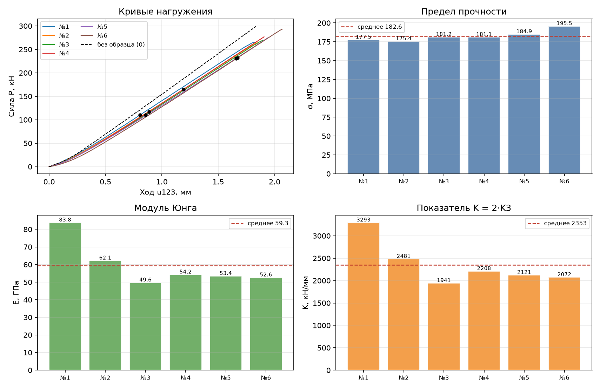

# Compression Test Recalculation

[English](README.md) | [Русский](README.ru.md)

A single-file Python program (Tkinter GUI + CLI) that recalculates compression
test data exported from a testing machine into Excel and **neutralizes the
machine's own compliance** using a reference run without a specimen. For a
series of specimens it computes stress, corrected displacements, stiffness
indicators and Young's modulus, shows summary statistics, and exports an Excel
report and charts.



## What it does

- Reads a multi-specimen Excel sheet: each specimen is a block of three
  columns (time, force, travel); any number of specimens.
- Uses **specimen 0** ("without specimen") to build the machine force–travel
  curve and subtract machine compliance from every specimen's recorded travel.
- For each specimen finds the point of maximum system stiffness on the loading
  branch (P123), splits the recorded travel u123 into the machine part u12 and
  the specimen deformation u3, and computes:
  - **K3 = P123 / u3** — specimen stiffness,
  - **K = 2·K3** — corrected stiffness indicator,
  - **σ = Pmax / A** — ultimate compressive stress,
  - **E = K·L / A** — Young's modulus,
  - plus series statistics: mean ± standard deviation and CV.
- Two interfaces: a **desktop GUI** and a **command line**.
- Exports: a formatted **Excel report** (summary, parameters, per-specimen
  curve sheets) and **PNG charts**.

## Requirements

- Python 3.10 or newer (developed and tested on 3.13)
- Packages: numpy, pandas, matplotlib, openpyxl

```bash
pip install -r requirements.txt
```

Tkinter ships with the standard Python installer on Windows; on Linux install
it with your package manager (e.g. `sudo apt install python3-tk`).

## Quick start

```bash
# GUI (opened automatically when the script is run without arguments)
python recalc_compression.py

# CLI: process a file; writes <prefix>_results.xlsx and <prefix>_charts.png
python recalc_compression.py data.xlsx

# CLI examples
python recalc_compression.py data.xlsx --length 33.6
python recalc_compression.py data.xlsx --samples 1,2,3 --out K-27
python recalc_compression.py data.xlsx --sheet 2 --area 113.1 --no-machine
```

A ready-made example is included: [examples/example_input.xlsx](examples/example_input.xlsx)
with the expected results in [examples/example_results.xlsx](examples/example_results.xlsx)
and [examples/example_charts.png](examples/example_charts.png). You can
regenerate it with `python tools/make_example_input.py`.

## Input file format

The input is a regular .xlsx/.xlsm sheet with a small header followed by the
data. Specimens are placed side by side, three columns each
(`Время | Сила | Ход` — time, force, travel):

```
      A        B       C        D        E       F        G        H       I
1   K-27                                        <- row 1: series label (any text)
2     0                         1                         2       <- row 2: specimen No.
3                               33.6                      34.0    <- row 3: height L, mm (optional)
4                               113.1                     113.4   <- row 4: contact area A, mm²
5   Время    Сила    Ход      Время    Сила    Ход      Время   ...    <- row 5: column headers
6   сек      Н       мм       сек      Н       мм       сек     ...    <- row 6: units (optional)
7   0.0      0       0.000    0.0      0       0.000    ...             <- data
```

| Row | Content |
|-----|---------|
| 1 | Series label (any text). |
| 2 | Specimen number for each block: `1, 2, 3, …`; `0` means the reference run *without* a specimen. |
| 3 | *(optional)* Specimen height L, mm. If absent, L is taken from `--length` / the GUI field / the default 33.6 mm. |
| 4 | Contact area A, mm². May be missing — then set it via `--area` / the GUI field. |
| 5 | Column headers, three per block: `Время \| Сила \| Ход` (Russian for *Time \| Force \| Travel* — the parser expects exactly these words). |
| 6 | *(optional)* Units row `сек \| Н \| мм` (s \| N \| mm); skipped automatically if present. |
| 7+ | Data: time [s], force [N], crosshead travel [mm]. |

Notes:

- The column headers must be the Russian words `Время`, `Сила`, `Ход` — this
  is the template used by the source data export. Data cells may use decimal
  commas and space thousands separators (`1 165,8`).
- Specimen numbers may be in any order; duplicates are renamed automatically
  with a warning.
- Without specimen 0 the machine compliance is not compensated (u12 = 0) and a
  warning is issued.
- The header rows are located automatically; the parser scans the first ~80
  rows of the sheet.

## CLI options

| Option | Description |
|--------|-------------|
| `xlsx` | input Excel file |
| `--sheet` | sheet: name or index (default: first) |
| `--length, -L` | specimen length (height), mm; if omitted — taken from the file header (otherwise 33.6) |
| `--m` | stiffness calculation window, points (default 250) |
| `--machine-smooth` | machine curve smoothing window, points (default 101) |
| `--samples` | specimen numbers to include, comma-separated, or `all` (default: all) |
| `--area` | contact area, mm² (fallback when the file has none) |
| `--no-machine` | do not account for machine compliance (ignore specimen 0) |
| `--out` | output file prefix (default: input file name) |

## Output

- **Console summary** — series info, calculation parameters, results table,
  means ± std, CV, notes and warnings.
- **`<prefix>_results.xlsx`** — sheets:
  - `Summary`: one row per specimen (A, L, Pmax, σ, P123, u123, u12, u3, K123,
    K12, K3, K = 2·K3, corrected K values, E, i\*, peak index, notes) plus
    means over selected specimens;
  - `Parameters`: calculation parameters and warnings;
  - `Specimen N`: P, u3, u123, u12 curve data for each selected specimen.
- **`<prefix>_charts.png`** — four-panel overview: loading curves with the
  "without specimen" reference, and per-specimen bars of σ, E and K with means.

In the GUI you can also export the same report and charts via the
**Export Excel…** and **Export charts…** buttons.

## Method in more detail

1. **Reference curve.** From specimen 0 the loading branch (up to the peak) is
   taken, sorted by force, smoothed with a moving-average window
   (`--machine-smooth`) and made monotonically increasing. Interpolation on
   this curve gives u12(P) — the machine's own travel under load P.
2. **Stiffness maximum.** For each specimen, stiffness k = ΔP/Δu is computed
   over a centered moving window of `m` points; the point i\* with the highest
   stiffness on the loading branch (before the peak) defines
   P123 = P(i\*) and u123 = u(i\*).
3. **Compliance subtraction.** u12 = u12(P123) is interpolated from the
   reference curve (extrapolated with a note if P123 lies beyond its range);
   u3 = u123 − u12 must be positive, otherwise the specimen is flagged as an
   error.
4. **Indicators.** K3 = P123/u3; K = 2·K3; σ = Pmax/A; E = K·L/A. Missing A or
   L are reported in the notes.

The synthetic example above lets you verify the whole chain: with a machine of
200 N/mm and specimen stiffnesses of 1000/1400 N/mm the program returns
exactly K3 = 1000/1400 N/mm, K = 2000/2800 N/mm, E = K·L/A.

## Notes and limitations

- With the default stiffness window `m = 250` a specimen block needs more than
  500 data rows (n > 2·m); reduce `m` (e.g. `--m 50`) for short records.
- The parser expects the Russian column headers `Время | Сила | Ход`; see the
  input format section above.
- A block with fewer than 10 finite data rows is rejected.
- Calculated per specimen: if the travel or force curves contain gaps
  (non-finite cells), those rows are dropped before the calculation.

## Repository layout

```
compression-test-recalc/
├── recalc_compression.py        # the program (single file, GUI + CLI)
├── requirements.txt
├── LICENSE
├── examples/
│   ├── example_input.xlsx       # sample input file (Russian header template)
│   ├── example_results.xlsx     # program output for the sample
│   └── example_charts.png       # program output charts
└── tools/
    └── make_example_input.py    # script that regenerates the sample input
```

## License

[MIT](LICENSE) © Vitali Shekov
